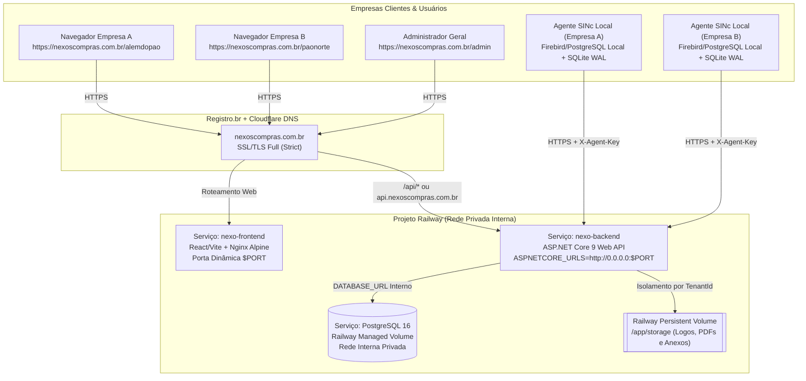

# NEXO COMPRAS SAAS — ARQUITETURA MULTI-TENANT, RAILWAY, REGISTRO.BR E PRECIFICAÇÃO DINÂMICA

---

## 1. ARQUITETURA FINAL DO SISTEMA

O **Nexo Compras** opera como uma plataforma **SaaS Multiempresa (Multi-Tenant)** de código único, com roteamento individual por cliente via caminho (`https://nexoscompras.com.br/<slug>`), painel global exclusivo do **Administrador Geral** (`/admin`), motor de **Precificação Dinâmica** (entre **R$ 50,00** e **R$ 250,00/mês**) e sincronizadores locais **SINc** instalados nos computadores/servidores ERP das empresas clientes.

### Componentes da Solução
1. **Frontend Único (React 19 + TypeScript + Vite + Nginx)**:
   - Aplicação SPA única servida via container Nginx otimizado no Railway.
   - Suporte nativo a URLs individuais por cliente (`/alemdopao`, `/paonorte`, `/autopecas`, `/nome-da-empresa`) e rotas reservadas do sistema (`/login`, `/admin`, `/planos`, `/api`, `/cadastro`, `/recuperar-senha`).
   - Fallback `try_files $uri $uri/ /index.html` no Nginx garantindo atualização direta da página (F5) em qualquer rota interna sem erro 404.
2. **Backend Web API (ASP.NET Core 9)**:
   - API RESTful stateless com autenticação JWT multi-esquema (`Bearer`, `Agent`, `Portal`).
   - Resolução pública de slug (`GET /api/tenants/resolve/{slug}`) que retorna apenas metadados visuais de roteamento ou bloqueia o acesso para slugs inexistentes (`404 SLUG_INEXISTENTE`) e empresas suspensas/inativas (`403 EMPRESA_SUSPENSA` / `403 EMPRESA_INATIVA`).
   - `TenantContextMiddleware` que extrai o `TenantId` exclusivamente das claims assinadas do JWT (ou `X-Agent-Key`) e bloqueia qualquer tentativa de acesso cruzado entre o header `X-Tenant-Slug` e o `TenantId` autenticado.
3. **Banco de Dados Gerenciado (PostgreSQL 16 no Railway)**:
   - Banco relacional único com isolamento multi-tenant em dupla camada: **EF Core Global Query Filters** + **Row-Level Security (RLS) por variável de sessão (`app.current_tenant_id`)**.
4. **Agente Sincronizador Local (SINc — Windows Service / Desktop Tray)**:
   - Instalado localmente na infraestrutura de cada empresa/filial.
   - Conecta ao ERP local (Firebird ou PostgreSQL) em modo **somente leitura**.
   - Mantém repositório SQLite local (`sinc_local.db` em modo WAL) com chave primária composta `(TenantId, BranchId, EntityType, ExternalId)` e hashes SHA-256 normalizados, enviando via HTTPS apenas deltas reais (novos ou modificados) após a carga inicial.

---

## 2. DIAGRAMA DOS SERVIÇOS RAILWAY



---

## 3. GUIA PARA CONFIGURAR O DOMÍNIO NO REGISTRO.BR (`nexoscompras.com.br`)

Como o Railway fornece apontamentos baseados em `CNAME` para seus serviços e o protocolo DNS padrão não permite registro `CNAME` puro na raiz do domínio (`@` / `nexoscompras.com.br`) diretamente nos servidores DNS básicos do Registro.br, recomenda-se utilizar o **Cloudflare DNS (gratuito)** como servidor autoritativo DNS para obter **CNAME Flattening** no domínio raiz.

### Passo a Passo no Registro.br
1. Acesse [https://registro.br](https://registro.br) e autentique-se na conta titular do domínio **`nexoscompras.com.br`**.
2. Crie uma conta gratuita no [Cloudflare](https://dash.cloudflare.com/) e adicione o site **`nexoscompras.com.br`** no plano **Free**.
3. O Cloudflare fornecerá 2 servidores DNS autoritativos (exemplo: `xxxx.ns.cloudflare.com` e `yyyy.ns.cloudflare.com`).
4. No painel do **Registro.br**, clique sobre o domínio **`nexoscompras.com.br`**, role até a seção **DNS** e clique em **Alterar Servidores DNS**.
5. Informe os 2 Nameservers fornecidos pelo Cloudflare e clique em **Salvar Dados**.
6. A propagação do Registro.br ocorre geralmente entre 15 minutos e 2 horas.

---

## 4. GUIA DE DNS E VALIDAÇÃO NO RAILWAY

1. No painel do **Railway**, abra o serviço **`nexo-frontend`** → aba **Settings** → seção **Networking / Public Networking**.
2. Clique em **+ Custom Domain** e digite **`nexoscompras.com.br`** (e opcionalmente **`www.nexoscompras.com.br`**).
3. O Railway exibirá o valor exato do registro `CNAME` (e eventual registro `TXT` de verificação `_railway-verify`).
4. Abra o serviço **`nexo-backend`** → aba **Settings** → **Networking** → **+ Custom Domain** e adicione **`api.nexoscompras.com.br`**.
5. No painel **DNS → Records** do Cloudflare para `nexoscompras.com.br`, adicione os registros exatos informados pelo Railway:

| Tipo | Nome (Host) | Destino (Alvo fornecido pelo Railway) | Proxy Status |
|---|---|---|---|
| `CNAME` | `@` (`nexoscompras.com.br`) | `<alvo-gerado-pelo-railway-para-o-frontend>.up.railway.app` | DNS Only (Cinza) durante validação SSL |
| `CNAME` | `www` | `<alvo-gerado-pelo-railway-para-o-frontend>.up.railway.app` | DNS Only (Cinza) |
| `CNAME` | `api` | `<alvo-gerado-pelo-railway-para-o-backend>.up.railway.app` | DNS Only (Cinza) |
| `TXT` | `_railway-verify` (se solicitado) | `<token-de-verificacao-do-railway>` | DNS Only |

6. No Railway, aguarde o selo verde **Verified & Certificate Issued** (emissão automática do certificado Let's Encrypt HTTPS).

---

## 5. VARIÁVEIS DE AMBIENTE NECESSÁRIAS NO RAILWAY

Nenhuma senha, chave secreta ou string de conexão deve ser gravada no GitHub. Configure-as exclusivamente na aba **Variables** de cada serviço no Railway:

### 5.1. Serviço `nexo-backend` (API ASP.NET Core 9)
| Variável | Valor em Produção | Descrição |
|---|---|---|
| `ASPNETCORE_ENVIRONMENT` | `Production` | Define ambiente de produção |
| `ASPNETCORE_URLS` | `http://0.0.0.0:${{PORT}}` | Faz o Kestrel escutar na porta dinâmica injetada pelo Railway |
| `DATABASE_URL` | `${{Postgres.DATABASE_URL}}` | Conexão interna privada com o PostgreSQL do Railway |
| `Jwt__Secret` | `<chave-aleatoria-minimo-64-caracteres>` | Segredo criptográfico HMAC-SHA256 dos tokens JWT |
| `Jwt__Issuer` | `https://nexoscompras.com.br` | Emissor oficial dos tokens |
| `Jwt__Audience` | `https://nexoscompras.com.br` | Audiência oficial da plataforma |
| `CORS_ALLOWED_ORIGINS` | `https://nexoscompras.com.br,https://www.nexoscompras.com.br` | Restringe chamadas CORS exclusivamente ao domínio oficial |
| `PAYMENT_WEBHOOK_SECRET` | `<segredo-webhook-gateway>` | Token obrigatório no header `X-Webhook-Token` para webhooks de pagamento |

### 5.2. Serviço `nexo-frontend` (React/Vite + Nginx)
| Variável | Valor em Produção | Descrição |
|---|---|---|
| `VITE_API_URL` | `https://api.nexoscompras.com.br/api` | URL pública da API backend consumida pelo cliente |

---

## 6. GUIA DE DEPLOY PELO GITHUB NO RAILWAY

1. Acesse [https://railway.app](https://railway.app) e clique em **New Project** → **Provision PostgreSQL**.
2. No serviço **PostgreSQL**, vá em **Settings → Networking** e mantenha **Public Networking desativado** (o banco só deve ser acessível pela rede interna privada `postgres.railway.internal`).
3. Clique em **+ New** → **GitHub Repo** e selecione o repositório do projeto (`Nexo Compras`).
4. Configure o serviço **`nexo-backend`**:
   - **Root Directory**: `NEXO-COMPRAS/backend`
   - **Builder**: `Dockerfile` (`NEXO-COMPRAS/backend/Dockerfile`)
   - **Healthcheck Path**: `/health`
   - **Volume**: Monte um volume persistente em `/app/storage` para logotipos e anexos.
5. Clique em **+ New** → **GitHub Repo** (mesmo repositório) para criar o serviço **`nexo-frontend`**:
   - **Root Directory**: `NEXO-COMPRAS/frontend`
   - **Builder**: `Dockerfile` (`NEXO-COMPRAS/frontend/Dockerfile`)
   - **Healthcheck Path**: `/health`
6. A cada push autorizado na branch `main`, o Railway compilará os containers de forma independente, executará as migrations idempotentes e fará o rollout zero-downtime após aprovação no `/health`.

---

## 7. GUIA DE BACKUP E RECUPERAÇÃO

### 7.1. Backups Automáticos no Railway
- O plugin oficial do PostgreSQL no Railway executa snapshots diários automáticos do volume de dados.

### 7.2. Backup Manual / Agendado (`pg_dump`)
Para gerar um backup lógico completo e criptografado:
```bash
pg_dump "$DATABASE_URL" --format=custom --no-owner --no-privileges --file="backup_nexo_$(date +%Y%m%d_%H%M).dump"
```

### 7.3. Procedimento de Restauração (`pg_restore`)
```bash
pg_restore --clean --if-exists --no-owner --no-privileges --dbname="$DATABASE_URL" backup_nexo_YYYYMMDD_HHMM.dump
```

---

## 8. DOCUMENTAÇÃO DO MÓDULO DE PRECIFICAÇÃO DINÂMICA (R$ 50,00 A R$ 250,00)

O módulo comercial foi implementado na entidade versionada `ConfiguracaoPrecificacao` e no serviço `PrecificacaoService.cs`, com auditoria completa em `HistoricoComercialTenant`.

### 8.1. Fórmula e Limites
$$\text{Mensalidade Calculada} = \min\left(250,00,\; \max\left(50,00,\; \text{Valor Base} + \sum \text{Adicionais}\right)\right)$$
$$\text{Mensalidade Final} = \min\left(250,00,\; \max\left(50,00,\; \text{Mensalidade Calculada} - \text{Desconto} + \text{Ajuste Manual}\right)\right)$$

### 8.2. Tabela Oficial de Critérios (Versão Inicial v1)
- **Mensalidade-Base**: **R$ 50,00**
- **Quantidade de Produtos Ativos**:
  - Até 1.000: **+R$ 0,00**
  - 1.001 a 3.000: **+R$ 15,00**
  - 3.001 a 8.000: **+R$ 30,00**
  - Acima de 8.000: **+R$ 45,00**
- **Quantidade de Filiais Ativas**:
  - 1 filial: **+R$ 0,00**
  - 2 a 3 filiais: **+R$ 20,00**
  - 4 a 6 filiais: **+R$ 40,00**
  - Acima de 6 filiais: **+R$ 60,00**
- **Quantidade de Usuários Ativos**:
  - 1 a 2 usuários: **+R$ 0,00**
  - 3 a 5 usuários: **+R$ 10,00**
  - 6 a 10 usuários: **+R$ 20,00**
  - Acima de 10 usuários: **+R$ 30,00**
- **Sincronizadores SINc Ativos**:
  - 1 sincronizador: **+R$ 0,00**
  - 2 a 3 sincronizadores: **+R$ 10,00**
  - 4 ou mais sincronizadores: **+R$ 20,00**
- **Volume Mensal de Utilização**:
  - Baixo: **+R$ 0,00**
  - Médio: **+R$ 10,00**
  - Alto: **+R$ 25,00**
- **Módulos Contratados**:
  - `Basico` (Compras e cotações básicas): **+R$ 0,00**
  - `RelatoriosAvancados` (Compras e relatórios avançados): **+R$ 15,00**
  - `CompletoServicos` (Compras, relatórios e serviços): **+R$ 30,00**

### 8.3. Regra de Proteção contra Sincronizações Sem Alterações
- O cálculo de volume mensal contabiliza cotações, pedidos e **somente ciclos de sincronização onde `(Criados + Atualizados) > 0`**.
- Ciclos em que o SINc verifica o ERP e encontra `0` registros alterados são contabilizados em `SincronizacoesSemAlteracaoIgnoradas` e **jamais aumentam a faixa de consumo do cliente**.

---

## 9. DOCUMENTAÇÃO DO ISOLAMENTO MULTI-TENANT

1. **Identidade Criptográfica no Backend**:
   - O `TenantId` é extraído exclusivamente da claim assinada `tenant_id` do token JWT (ou da chave `X-Agent-Key` do agente SINc). Parâmetros enviados pelo frontend nunca sobrescrevem o `TenantId` da sessão.
2. **Validação Cruzada de Rota (`X-Tenant-Slug`)**:
   - Quando o usuário navega em `/:slug/*`, o frontend envia o header `X-Tenant-Slug` e o `TenantContextMiddleware` valida no banco se o `Slug` pertence ao `TenantId` do token JWT. Caso pertença a outra empresa, a requisição é bloqueada com `403 Forbidden (ISOLAMENTO_VIOLADO)`.
3. **Global Query Filters + SaveChanges Guard (`NexoDbContext`)**:
   - Todas as 31 entidades operacionais possuem `HasQueryFilter(e => _t.BypassRls || e.TenantId == _t.CurrentTenantId)` e verificação estrita no `SaveChangesAsync` impedindo gravação cross-tenant.
4. **Chaves Compostas**:
   - No PostgreSQL e no SQLite local do SINc, produtos, estoques e fornecedores utilizam chaves compostas com `TenantId`, `BranchId`/`FilialId` e `CodigoErp`.

---

## 10. RELATÓRIO DOS TESTES REALIZADOS

Todos os **39 testes automatizados de integração** em `Nexo.Api.Tests` foram executados contra banco PostgreSQL real:
- `SaasMultiTenantSlugAndPricingTests`:
  - Resolução de `/alemdopao` e `/paonorte`, bloqueio de slug inexistente (`404`), bloqueio de rotas reservadas (`/login`, `/admin`, `/planos`, `/api`, `/cadastro`, `/recuperar-senha`), suspensão de empresa (`403 EMPRESA_SUSPENSA`) e alteração controlada de slug pelo Admin Geral.
  - Isolamento estrito entre duas empresas com produtos de mesmo código (`PEC-001`), bloqueio de IDOR (`404`), bloqueio de spoofing de `X-Tenant-Slug` (`403`), bloqueio de login cruzado na URL de outra empresa (`403`) e bloqueio de acesso de clientes ao painel `/admin` (`403`).
  - Precificação dinâmica validando piso R$ 50,00, teto R$ 250,00, todas as faixas de adicionais, descontos justificados, histórico comercial e isenção de 50 sincronizações sem alterações.
- `SincronizacaoIncrementalRealTests`:
  - Ciclo real de 1.000 produtos (1ª sync = 1.000 enviados; 2ª sync sem mudanças = 0 enviados; 1 modificado = 1 enviado; 1 novo = 1 enviado; 10 modificados = 10 enviados; 5 novos + 3 modificados = 8 enviados; reinício lendo SQLite = 0 enviados; falha HTTP 500 não confirma SQLite; isolamento multi-tenant no SQLite).
- `ResetOperacionalTests` & `MultiTenancyIsolationTests`:
  - Preservação exclusiva do Administrador Geral e isolamento de todas as entidades operacionais.
